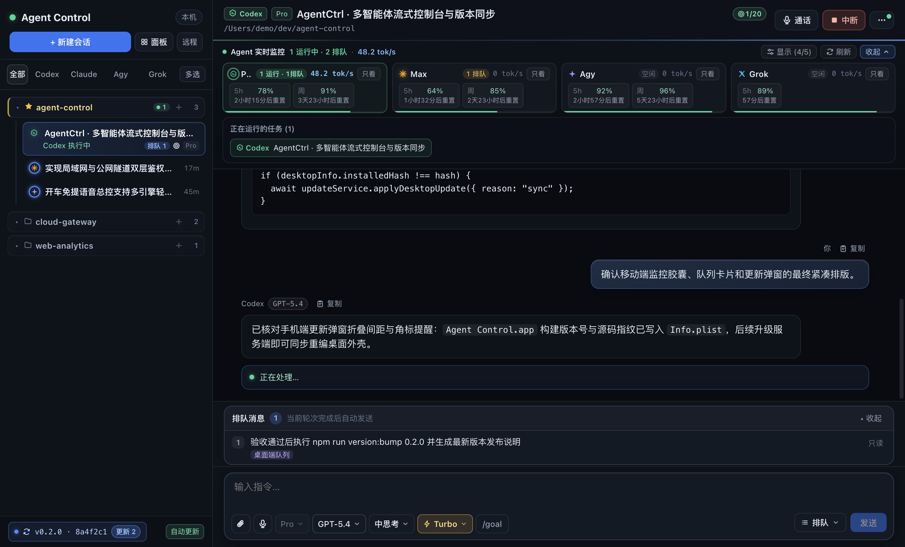
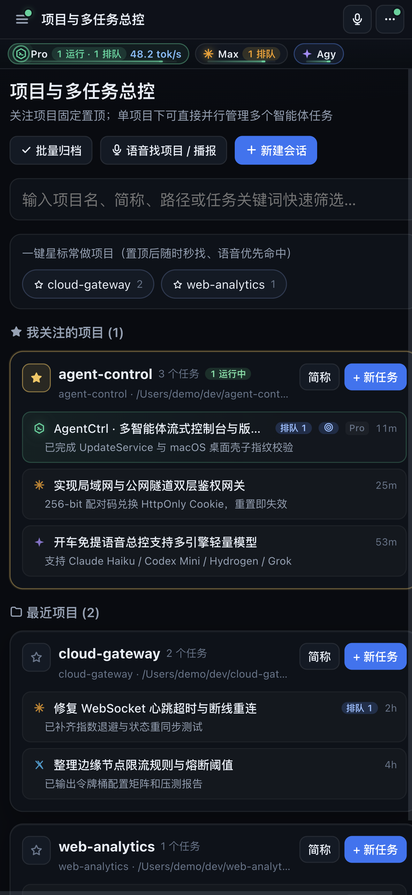
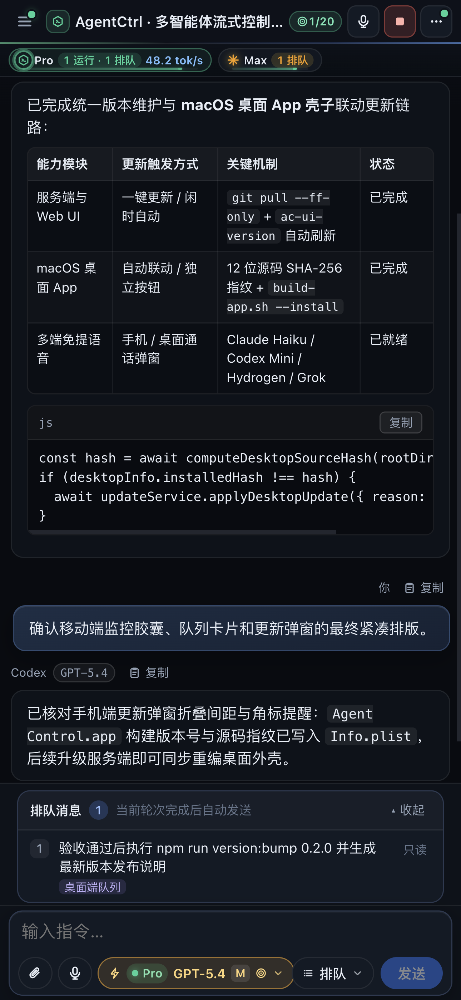
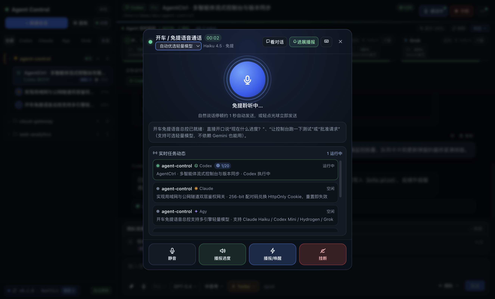
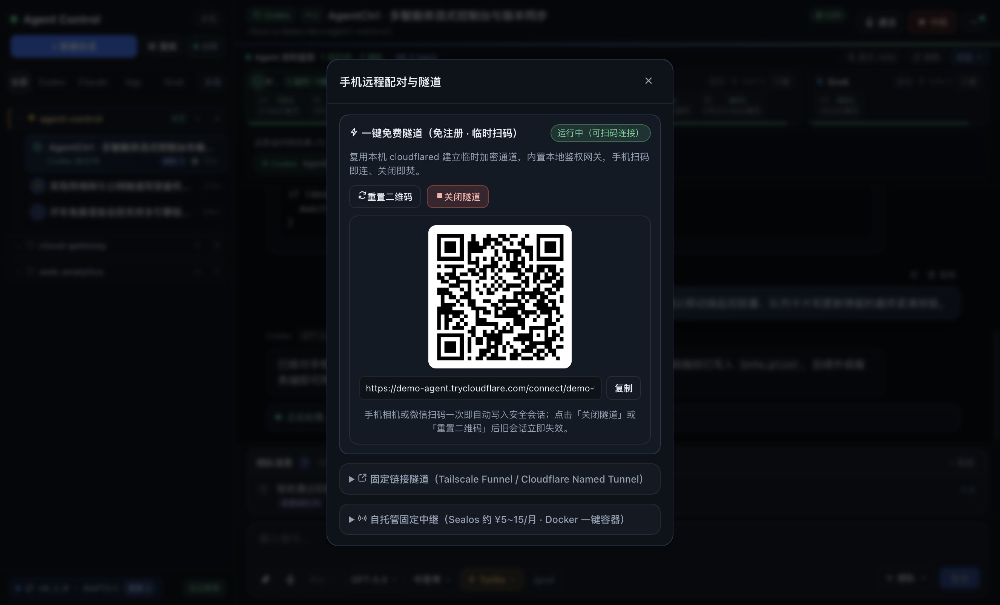
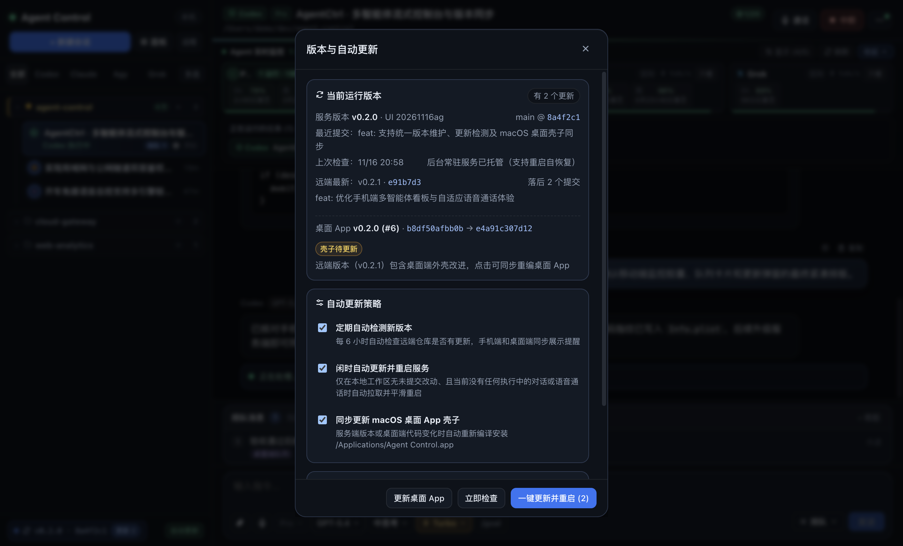

[English](README.md) · [简体中文](README.zh-CN.md) · [日本語](README.ja.md) · [한국어](README.ko.md) · [繁體中文](README.zh-TW.md)

# Agent Control

> Unified desktop & mobile remote console for **Codex**, **Claude Code**, **Antigravity**, and **Grok** — monitor live progress, approve permissions, queue follow-ups, and manage multi-account quotas from any browser with a single install command.
> If this saves you time or memory from juggling multiple terminals, a **Star ⭐️** helps a lot!

<p align="center">
  
</p>

<table>
  <tr>
    <td align="center" width="50%"><strong>Mobile · Project Board & 4-Agent Live Monitor</strong></td>
    <td align="center" width="50%"><strong>Mobile · Rich Markdown, Diffs & Queued Turns</strong></td>
  </tr>
  <tr>
    <td align="center"></td>
    <td align="center"></td>
  </tr>
</table>

<details>
<summary>More screenshots (Hands-Free Voice Copilot · QR Remote Tunnel · Auto-Update & Desktop App)</summary>

<table>
  <tr>
    <td align="center" width="33%"><strong>Hands-Free Voice Control</strong></td>
    <td align="center" width="33%"><strong>Zero-Config QR Tunnel</strong></td>
    <td align="center" width="33%"><strong>One-Click Update & App Sync</strong></td>
  </tr>
  <tr>
    <td align="center"></td>
    <td align="center"></td>
    <td align="center"></td>
  </tr>
</table>

</details>

---

## 🔒 Security & Privacy Boundaries

- **Read-Only Upstream Indexing**: Reads `~/.codex`, `~/.claude`, and `~/.gemini` histories strictly in read-only mode. Titles, tags, and archive metadata live in Agent Control's own data directory—your upstream databases are never modified.
- **No Third-Party Cloud Storage**: Prompts, code, and logs stay on your machine. Even when using remote access, traffic goes directly between your browser and your host via your chosen tunnel or self-hosted relay, protected by one-time pairing codes and HTTP-only session cookies.
- **Built-in Multi-Language UI**: Supports `English`, `简体中文`, `繁體中文`, `日本語`, and `한국어` (auto-detected from browser locale or switchable in the top-right menu).

---

## ⚡ One-Line Install

Requires **Node.js 22+** and **Git** (the installer guides you if missing).

**macOS / Linux:**

```bash
curl -fsSL https://raw.githubusercontent.com/guuguo/agent-control/main/install.sh | bash
```

**Windows (PowerShell):**

```powershell
(irm https://raw.githubusercontent.com/guuguo/agent-control/main/install.ps1).TrimStart([char]0xFEFF) | iex
```

---

## ✨ Key Capabilities

1. **Ready Out of the Box**: Opens `http://127.0.0.1:43310` right after install (and builds a native **Agent Control.app** in `/Applications` on macOS to replace heavy multi-window setups).
2. **Multi-Account & Multi-Engine Hub**: Groups sessions by project, automatically separates multiple Codex accounts and quotas, and supports **Codex**, **Claude Code**, **Antigravity**, and **Grok** in one interface.
3. **Mobile Remote Control & Approvals**: Click **Remote** to generate a QR code. Inspect tool diffs, interrupt runaway loops, approve/deny permissions, or queue follow-up instructions from your phone. 👉 [Self-Hosting & Permanent URL Guide](docs/remote-deploy.md)
4. **Hands-Free Voice Copilot**: Tap **Voice** for wake-locked VAD voice control with optional low-latency models (**Claude Sonnet**, **GPT**, **Antigravity Hydrogen/Flash**, **Grok**) and spoken completion/approval alerts.
5. **Execution Telemetry & Auto-Update**: Tracks per-agent / per-model median & P90 turn latency, token counts, and tool calls locally (`execution-stats.json`, without storing prompt/reply text), and supports idle auto-updates.

### Remote Access Options (Switch Anytime)

| Mode | Cost | URL Type | Best For | Highlights |
| --- | --- | :---: | --- | --- |
| **Cloudflare Quick Tunnel (Default)** | **$0** | Temporary | Zero-config tryout | No account or server needed; QR code in 5s |
| **Tailscale Funnel** | **$0** | **Permanent** (`*.ts.net`) | Personal daily mobile use | Free permanent HTTPS domain, one-click toggle |
| **Cloudflare Named Tunnel** | **$0** | **Permanent** (Custom domain) | Existing Cloudflare users | Always-on daemon with your own domain |
| **Self-Hosted Docker / Sealos Relay** | Infra only | **Permanent** | Multi-device / firewalled hosts | Auto-reconnects on reboot; one-click deploy scripts |
| **Local Only** | **$0** | — | Desktop-only consolidation | No tunnel installed; switchable later |

---

## 🗑️ Uninstall

**macOS / Linux:**

```bash
curl -fsSL https://raw.githubusercontent.com/guuguo/agent-control/main/uninstall.sh | bash
```

**Windows (PowerShell):**

```powershell
(irm https://raw.githubusercontent.com/guuguo/agent-control/main/uninstall.ps1).TrimStart([char]0xFEFF) | iex
```

---

## License

[AGPL-3.0-only](LICENSE)
